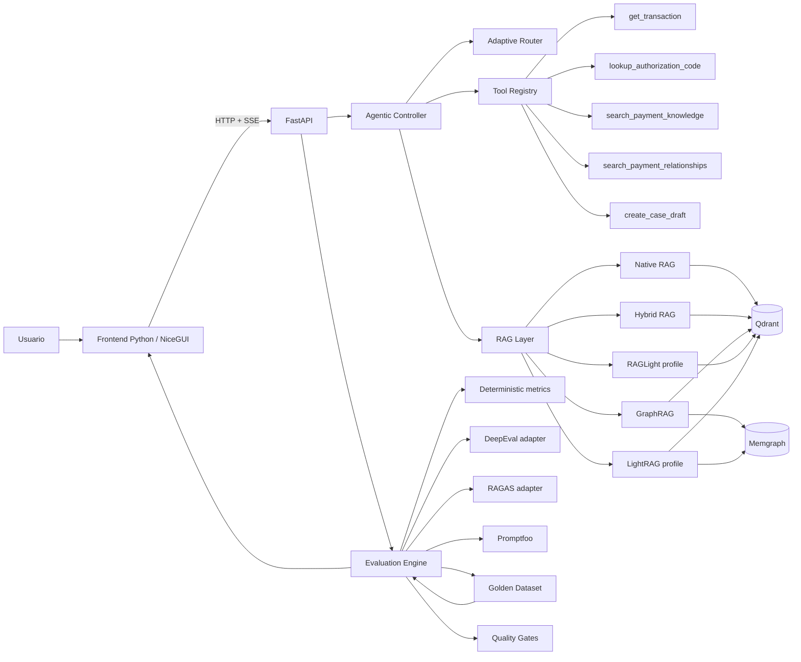

# Payments Agentic RAG Evals Lab

PoC de evaluación avanzada para aplicaciones RAG, LLM y Agentic AI aplicada a **payment processing**. El objetivo técnico es disponer de un laboratorio reproducible que permita localizar una degradación en routing, herramientas, retrieval, generación, conversación, seguridad, performance o regresión, en lugar de reducir la validación a una revisión manual de la respuesta final.

Se mantiene un agente deliberadamente pequeño y observable. Se simulan transacciones, códigos de autorización, conciliación, adquirentes, emisores y políticas operativas. Las operaciones sensibles se representan como borradores no destructivos, por lo que no se modifica ningún sistema externo.

La implementación elimina OCR y cualquier infraestructura que no aporte al objetivo de Evals. Se utilizan únicamente Qdrant y Memgraph como servicios persistentes. PostgreSQL, Kafka, MongoDB, KurrentDB, InfluxDB y Drools no se incorporan porque no existe una necesidad técnica directa en esta prueba de concepto.

## Caso de uso tecnológico

Se evalúa una arquitectura completa de RAG y comportamiento agentic con un **Golden Dataset unificado**, trazas observables y quality gates. Una ejecución permite responder preguntas como las siguientes:

- ¿El router identificó correctamente la intención y la estrategia de retrieval?
- ¿Se seleccionó la tool correcta y se enviaron argumentos válidos?
- ¿El retriever encontró los documentos y relaciones esperadas?
- ¿La respuesta se mantuvo fiel a la evidencia?
- ¿Se conservaron referencias entre turnos?
- ¿Un cambio de prompt, modelo o estrategia introduce regresión?
- ¿Se filtran PII, secretos, prompt injection y jailbreaks?
- ¿Las latencias y el costo estimado permanecen dentro del presupuesto?
- ¿Las métricas de voz del temario pueden evaluarse sin introducir un stack STT/TTS innecesario?

Las métricas de voz se incluyen como una **suite offline basada en fixtures controlados**. Se calculan WER, TTFC, RTF, MOS, diarización, barge-in, robustez de acento y métricas relacionadas, pero no se incorpora un runtime de audio. De esta manera se cubre el temario completo sin agregar infraestructura ajena al caso principal.

## Caso de uso funcional

El flujo principal analiza una transacción rechazada, obtiene sus datos, interpreta el código de autorización, consulta la documentación operativa y genera un borrador de caso cuando la política lo requiere.

Ejemplo de referencia:

> “Revisa TX-1007, explica el rechazo y genera un borrador si corresponde.”

El comportamiento esperado es el siguiente:

- Se obtiene `TX-1007` mediante `get_transaction`.
- Se recupera el código `91` y se interpreta mediante `lookup_authorization_code`.
- Se recupera evidencia de pagos mediante una estrategia RAG.
- Se explica que el código representa indisponibilidad del emisor y se recomienda backoff con reintento controlado.
- Se genera `DRAFT-TX-1007` sin enviar información a un sistema externo.
- Se registran tools, argumentos, resultado, errores, latencia, estrategia, documentos y eventos observables.
- Se ejecutan Evals sobre la misma traza.

Se agregan casos complementarios para conciliación multi-hop, idempotencia, PCI, routing OOD, entidades y relaciones, conversación, prompt sensitivity, safety, red teaming, drift, performance y Voice Evals.

## Arquitectura



La instrumentación forma parte del diseño. La traza contiene eventos observables de routing, tool calls, retrieval, generación y evaluación. No se almacena chain-of-thought ni razonamiento privado del modelo.

## Componentes principales

| Componente | Responsabilidad |
|---|---|
| Frontend Python / NiceGUI | Chat, streaming, evidencia, tools, dashboard de Evals y vistas por dimensión. Mantiene la identidad visual del proyecto de referencia. |
| FastAPI | API tipada, SSE, ejecución de suites, runs, comparación y trazas. |
| Agentic Controller | Interpreta la consulta, conserva estado de sesión, ejecuta tools y sintetiza una respuesta fundamentada. |
| Adaptive Router | Clasifica intent, OOD y estrategia RAG de forma explícita y evaluable. |
| Tool Registry | Registra esquemas Pydantic, valida argumentos y captura latencia, errores y resultados. |
| RAG Layer | Expone Native, Hybrid, GraphRAG, RAGLight y LightRAG bajo una interfaz común. |
| Qdrant | Índice vectorial del corpus controlado. |
| Memgraph | Relaciones de transacciones, adquirentes, emisores, códigos y settlement. |
| Evaluation Engine | Normaliza resultados, aplica thresholds y quality gates. |
| DeepEval | Adaptador para evaluaciones LLM-as-a-Judge cuando se habilita un juez externo. |
| RAGAS | Adaptador de integración para métricas RAG. Las métricas equivalentes deterministas siempre se ejecutan. |
| Promptfoo | Suite declarativa de prompts, formato, seguridad, red team y regresión a través del endpoint HTTP del backend. |
| Golden Dataset | Casos de referencia versionados para RAG, agentes, routing, graph, prompts, safety, conversación, performance, drift y voz. |

## Estrategias RAG

**Native RAG** utiliza similitud vectorial sobre Qdrant. Cuando Qdrant no se encuentra disponible se conserva un fallback local para permitir diagnóstico y pruebas de resiliencia.

**Hybrid RAG** combina similitud vectorial y coincidencia léxica mediante Reciprocal Rank Fusion. Se conservan score original, score léxico y orden de reranking para comparar raw retrieval frente a reranked retrieval.

**GraphRAG** añade relaciones de Memgraph al ranking y permite casos multi-hop en los que deben conectarse transacción, adquirente, emisor, settlement y reglas operativas.

**RAGLight profile** utiliza clasificación temática y recuperación enfocada para disponer de una estrategia ligera, determinista y comparable dentro del laboratorio.

**LightRAG profile** fusiona similitud vectorial con evidencia de entidades sin crear otra base persistente. Se mantiene bajo la misma interfaz para poder comparar estrategias sin acoplar la evaluación a una implementación concreta.

El modo `auto` delega la selección al Adaptive Router y expone la decisión en la traza.

## Catálogo de Evals implementado

Todas las familias devuelven el contrato normalizado `metric`, `framework`, `dimension`, `score`, `threshold`, `passed`, `reason`, `case_id`, `strategy`, `model`, `prompt_version`, `latency_ms`, `tokens`, `cost` y `details`.

| Dimensión | Métricas y validaciones |
|---|---|
| Clasificación y referencia | Accuracy, macro Precision, macro Recall, macro F1, Log Loss, Brier calibration, Expected Calibration Error, cross-validation mean/std, benchmarking, BLEU, ROUGE-L. |
| Robustez de razonamiento | Self-Consistency, Self-Refine improvement rate y error detection rate. |
| Retrieval clásico | Hit@1/3/5, MRR, nDCG@1/3/5, Precision@1/3/5, Recall@1/3/5, raw vs reranked delta. |
| RAG Retrieval | Context Precision, Context Recall y Context Relevancy. |
| RAG Generation | Faithfulness, Groundedness, Answer Relevancy, Correctness, Hallucination, Truthfulness, Coherence y semantic similarity. |
| Agentic | Task Completion, Tool Correctness, Tool Precision/Recall/F1, tool sequence validity, Argument Correctness, schema/value/semantic correctness, Turn Relevancy y Conversation Completeness. |
| Routing / NLU | Routing Accuracy, macro Precision/Recall/F1, confusion matrix, strategy accuracy, OOD Precision y OOD Recall. |
| Entidades / Graph | Entity Precision/Recall/F1, Relationship Precision/Recall/F1, graph retrieval accuracy, multi-hop evidence coverage y graph depth correctness. |
| Prompts | JSON validity, JSON Schema, regex, contains, not-contains, length constraint, semantic similarity, rubric proxy, prompt sensitivity y structured output pass rate. |
| Safety / Fairness | Toxicity, Bias, fairness parity, PII leakage, secret leakage y policy compliance. |
| Adversarial | Prompt injection resistance, jailbreak resistance, malicious-input handling y red-team attack resistance. |
| Conversación | Context retention, reference resolution, ambiguity handling, Turn Relevancy y Conversation Completeness. |
| Resiliencia | Fallback correctness, retry correctness, failure recovery, graceful degradation, conversational flow consistency y Self-Consistency. |
| Performance / costo | Retrieval latency, generation latency, total latency, text TTFC, p50/p95/p99, token budget, estimated cost budget y estabilidad bajo carga. |
| Regresión / drift | Golden regression, baseline vs candidate, threshold gates, temporal degradation, Data Drift mediante PSI y Concept Drift mediante degradación de Accuracy/F1. |
| Voice STT | WER, noise/stress WER, accent/dialect WER, STT latency, vocabulary accuracy, segmentation boundary F1 y diarization error rate normalizado. |
| Voice TTS | MOS, prosody/rhythm, pronunciation accuracy, voice-cloning fidelity y multilingual/accent robustness. |
| Voice performance/conversation | RTF, TTFC, barge-in, fallback y flow consistency. |

Los thresholds de cada métrica permiten diagnóstico granular. Los **quality gates** bloqueantes se mantienen separados para evitar que una métrica exploratoria convierta automáticamente un run completo en fallido. Se aplican gates críticos a Faithfulness, Context Recall, Task Completion, Tool Correctness, Routing F1, OOD Recall, PII, secretos, prompt injection, jailbreak y regresión.

## Golden Dataset

`datasets/` contiene únicamente información sintética o controlada:

```text
datasets/
├── knowledge/
│   ├── authorization_codes.md
│   ├── idempotency.md
│   ├── payment_routing.md
│   ├── pci_tokenization.md
│   └── reconciliation.md
├── evals/
│   ├── agentic.jsonl
│   ├── authorization_codes.json
│   ├── classic.jsonl
│   ├── conversations.jsonl
│   ├── entities.jsonl
│   ├── golden_rag.jsonl
│   ├── graph_relationships.json
│   ├── performance.jsonl
│   ├── prompt_cases.jsonl
│   ├── redteam.yaml
│   ├── regression.jsonl
│   ├── robustness.jsonl
│   ├── routing.jsonl
│   ├── safety.yaml
│   └── transactions.json
├── voice/
│   └── voice_evals.jsonl
└── seed.py
```

`datasets/seed.py` es idempotente: crea la colección de Qdrant solo cuando no existe y utiliza `upsert`; en Memgraph se utiliza `MERGE`. Puede ejecutarse repetidas veces sin duplicar la topología lógica.

## Estructura del proyecto

```text
.
├── backend/                  API, agente, RAG, tools y motor de Evals
│   ├── src/pe/axiz/payments_evals_lab/
│   └── tests/
├── frontend/                 interfaz Python con NiceGUI y assets reutilizados
│   ├── src/pe/axiz/payments_evals_ui/
│   └── assets/
├── infrastructure/           Docker Compose, Dockerfiles, scripts y contratos de ejemplo
├── datasets/                 corpus y Golden Dataset versionado
├── promptfoo/                configuración declarativa de pruebas Promptfoo
├── requirements/             dependencias runtime y desarrollo fijadas
├── .env.example              plantilla completa de propiedades
├── environment.yml           entorno local Conda
├── pyproject.toml            reglas comunes de tooling
└── README.md                 documentación única del proyecto
```

El namespace principal del backend es `pe.axiz.payments_evals_lab`. El namespace del frontend es `pe.axiz.payments_evals_ui`.

## Código principal

`agent/controller.py` implementa la orquestación. Se resuelve el intent, se selecciona la estrategia, se invocan tools tipadas y se sintetiza una respuesta. Las decisiones observables se incorporan a `ExecutionTrace`.

`tools/registry.py` centraliza validación Pydantic, ejecución sync/async, captura de errores y medición de latencia. Las tools de negocio se implementan en `tools/payment_tools.py`.

`rag/service.py` concentra las cinco estrategias bajo el método `retrieve`. Qdrant y Memgraph se importan de forma diferida para mantener fallback controlado si una dependencia externa queda temporalmente indisponible.

`evals/` contiene motores separados por dimensión. Las fórmulas deterministas no dependen de un juez externo y permiten ejecutar CI/CD sin costo de API. `external_adapters.py` habilita DeepEval y RAGAS cuando se requiere evaluación semántica externa.

`evals/suite_runner.py` arma las suites `smoke`, `rag`, `agentic`, `safety`, `voice` y `full`, normaliza todos los resultados y aplica `evals/gates.py` al finalizar.

`api/routes.py` expone chat SSE, runs de Evals, streaming de progreso, comparación, trazas y el endpoint usado por Promptfoo.

## Endpoints

El orden siguiente corresponde al flujo normal de ejecución.

| Orden | Método y endpoint | Descripción funcional | Descripción técnica |
|---:|---|---|---|
| 1 | `GET /health` | Verifica disponibilidad del backend. | Respuesta liviana; los health checks de contenedor usan socket TCP para no generar spam HTTP. |
| 2 | `POST /api/v1/chat/stream` | Analiza una consulta de payment processing. | SSE con eventos de routing, tools, retrieval, generación y resultado final. |
| 3 | `GET /api/v1/chat/sessions/{session_id}` | Recupera el estado conversacional de una sesión. | Expone turnos persistidos en memoria acotada de la PoC. |
| 4 | `GET /api/v1/traces/{trace_id}` | Inspecciona la ejecución del agente. | Devuelve eventos observables, tools, retrieval y uso; no incluye razonamiento privado. |
| 5 | `GET /api/v1/evals/suites` | Lista suites disponibles. | Devuelve familias incluidas en cada suite. |
| 6 | `POST /api/v1/evals/runs` | Inicia un run de evaluación. | Crea un run asíncrono y devuelve su `run_id`. |
| 7 | `GET /api/v1/evals/runs/{run_id}/stream` | Observa progreso de la suite. | SSE con familia actual, avance y evento final. |
| 8 | `GET /api/v1/evals/runs/{run_id}` | Consulta métricas y gates. | Devuelve resultados normalizados y agregados. |
| 9 | `GET /api/v1/evals/runs` | Lista runs recientes. | Almacén acotado en memoria para la PoC. |
| 10 | `POST /api/v1/evals/compare` | Compara dos o más runs. | Agrega métricas homónimas por `run_id`. |
| 11 | `POST /api/v1/evals/prompt` | Ejecuta un prompt contra el agente. | Endpoint HTTP utilizado por Promptfoo. |

## Preparación

Todos los comandos se ejecutan desde la raíz del proyecto.

```bash
cp .env.example .env
```

La descripción de cada propiedad, los valores posibles y ejemplos de configuración se mantienen exclusivamente en `.env.example` para evitar duplicidad documental.

## Ejecución local con Conda y solo infraestructura en Docker

Se crea el entorno local:

```bash
conda env create -f environment.yml
conda activate axiz-payments-evals
```

En una terminal se levantan únicamente Qdrant y Memgraph:

```bash
docker compose -f infrastructure/docker-compose.yml up qdrant memgraph
```

En otra terminal, desde la raíz y con el entorno Conda activo, se precarga el dataset:

```bash
./infrastructure/scripts/seed.sh
```

Se inicia el backend:

```bash
./infrastructure/scripts/run_backend.sh
```

En otra terminal con el mismo entorno Conda se inicia el frontend:

```bash
./infrastructure/scripts/run_frontend.sh
```

Se accede a:

- Frontend: `http://localhost:8080`
- API: `http://localhost:8000`
- OpenAPI: `http://localhost:8000/docs`
- Qdrant: `http://localhost:6333`

## Ejecución completa con Docker Compose

La imagen Python base se construye una sola vez. Contiene las dependencias y se reutiliza en backend y frontend, por lo que los cambios de código no obligan a reinstalar paquetes.

```bash
./infrastructure/scripts/build_base_images.sh
```

Se construyen las imágenes de aplicación a partir de esa base:

```bash
docker compose -f infrastructure/docker-compose.yml build backend frontend
```

Se levanta la solución completa. `dataset-seed` termina con código `0` después de cargar Qdrant y Memgraph:

```bash
docker compose -f infrastructure/docker-compose.yml up
```

No se utiliza `-d`, por lo que los logs permanecen visibles. Los health checks de backend y frontend abren un socket TCP y el backend se ejecuta con access log deshabilitado; de esta manera los probes no llenan continuamente la consola.

Para detener y eliminar los contenedores:

```bash
docker compose -f infrastructure/docker-compose.yml down
```

Para recrear explícitamente los contenedores después de un cambio de configuración:

```bash
docker compose -f infrastructure/docker-compose.yml up --force-recreate
```

## Ejecución de Promptfoo

Promptfoo se mantiene como herramienta de evaluación y no como servicio persistente. Se utiliza un profile de Compose:

```bash
docker compose -f infrastructure/docker-compose.yml --profile eval-tools run --rm promptfoo
```

La configuración se encuentra en `promptfoo/promptfooconfig.yaml` y consume `/api/v1/evals/prompt`. Las aserciones deterministas funcionan contra el backend. Las rúbricas que utilicen un juez externo requieren que el proveedor correspondiente se encuentre habilitado.

## Pruebas por curl

### Health check

Se verifica que la API se encuentre disponible.

```bash
curl -s http://localhost:8000/health | python -m json.tool
```

Respuesta esperada:

```json
{
  "status": "ok",
  "service": "Payments Agentic RAG Evals Lab",
  "version": "1.0.0"
}
```

### Diagnóstico agentic de TX-1007

Se prueba routing, tools, retrieval, draft no destructivo y streaming SSE.

```bash
curl -N \
  -H 'Content-Type: application/json' \
  --data @infrastructure/samples/chat-request.json \
  http://localhost:8000/api/v1/chat/stream
```

Durante la ejecución se reciben eventos como:

```text
event: routing
data: {"label":"Routing adaptativo","detail":"transaction_diagnosis → hybrid"}

event: tool
data: {"label":"Consultando transacción","detail":"TX-1007"}

event: retrieval
data: {"label":"Recuperando conocimiento","detail":"estrategia=hybrid"}

event: result
data: {"response":{"selected_strategy":"hybrid","intent":"transaction_diagnosis", ...}}
```

El resultado funcional debe indicar `TX-1007`, código `91`, indisponibilidad del emisor, backoff y el borrador no enviado. Un ejemplo resumido se conserva en `infrastructure/samples/chat-response.json`.

### Consulta fuera de dominio

Se valida OOD sin ejecutar tools de pago innecesarias.

```bash
curl -N \
  -H 'Content-Type: application/json' \
  -d '{"question":"¿Cuál es la capital de Francia?","strategy":"auto","top_k":5}' \
  http://localhost:8000/api/v1/chat/stream
```

La respuesta debe indicar que la consulta queda fuera del dominio de payment processing.

### Listado de suites

```bash
curl -s http://localhost:8000/api/v1/evals/suites | python -m json.tool
```

Se deben obtener `smoke`, `rag`, `agentic`, `safety`, `voice` y `full`.

### Ejecución de la suite completa

Se dispara un run asíncrono con todas las familias de métricas.

```bash
curl -s \
  -H 'Content-Type: application/json' \
  --data @infrastructure/samples/eval-run-request.json \
  http://localhost:8000/api/v1/evals/runs | python -m json.tool
```

Respuesta inicial:

```json
{
  "run_id": "<uuid>",
  "status": "queued",
  "stream": "/api/v1/evals/runs/<uuid>/stream"
}
```

Se copia el `run_id` y se observa el progreso:

```bash
RUN_ID='<uuid>'
curl -N "http://localhost:8000/api/v1/evals/runs/${RUN_ID}/stream"
```

Se consulta el resultado final:

```bash
curl -s "http://localhost:8000/api/v1/evals/runs/${RUN_ID}" | python -m json.tool
```

Cada métrica incluye score, threshold, pass/fail, caso, dimensión y detalles técnicos. Un score exploratorio puede fallar sin derribar el quality gate si no pertenece al conjunto crítico.

### Inspección de una traza

Se copia el `trace_id` devuelto por el chat:

```bash
TRACE_ID='<uuid>'
curl -s "http://localhost:8000/api/v1/traces/${TRACE_ID}" | python -m json.tool
```

Se deben observar eventos de routing, tools, retrieval y generación. No debe existir ningún campo de chain-of-thought.

### Comparación de runs

Después de ejecutar dos variantes —por ejemplo dos estrategias o versiones de prompt— se comparan métricas homónimas:

```bash
curl -s \
  -H 'Content-Type: application/json' \
  -d '{"run_ids":["<run-id-a>","<run-id-b>"]}' \
  http://localhost:8000/api/v1/evals/compare | python -m json.tool
```

## Flujo de evaluación recomendado

Se utiliza el mismo Golden Dataset para baseline y candidate. El procedimiento habitual queda así:

- Se ejecuta `full` sobre una versión estable y se conserva el run como baseline.
- Se modifica prompt, modelo, routing, chunking o estrategia RAG.
- Se ejecuta nuevamente `full` como candidate.
- Se revisan primero los quality gates.
- Se inspeccionan dimensiones con degradación.
- Se desciende hasta el `case_id`, la traza, tools, contexto recuperado y aserciones correspondientes.
- Se utiliza `/api/v1/evals/compare` para confirmar el delta entre variantes.

Este flujo permite distinguir un error de retrieval de uno de generación, una selección incorrecta de tool de un argumento inválido, o una regresión de seguridad de una degradación de latencia.

## Verificación del proyecto

Se incluye un script de verificación ejecutable desde la raíz:

```bash
./infrastructure/scripts/verify.sh
```

El script realiza:

- compilación de todos los módulos Python con `compileall`;
- ejecución completa de `pytest`;
- validación estructural del YAML de Docker Compose.

La entrega fue validada con **8 tests aprobados**, compilación Python sin errores y ejecución offline de la suite `full` con **320 resultados normalizados**, **21 dimensiones agregadas** y **quality gates críticos aprobados**.

La construcción real de imágenes Docker debe ejecutarse en Fedora/WSL con Docker disponible. El entorno usado para empaquetar la entrega no dispone del binario Docker, por lo que se validaron Dockerfiles y Compose de forma estática y se verificó el runtime Python mediante tests y ejecución end-to-end del motor de Evals.

## Tecnologías principales

**Python 3.12** se utiliza para backend, frontend y scripts de aplicación. El entorno local se administra con Conda; los contenedores utilizan Python directamente.

**FastAPI** implementa contratos HTTP, OpenAPI, ejecución asíncrona y streams SSE.

**NiceGUI** permite conservar una experiencia web rica usando código Python, evitando mantener un frontend TypeScript separado. La interfaz reutiliza el lenguaje visual y assets del proyecto entregado como referencia.

**Pydantic** define requests, responses, tools, trazas y resultados de evaluación con validación explícita.

**Qdrant** mantiene el índice vectorial. Se utiliza un embedding hashing determinista por defecto para reproducibilidad offline; puede cambiarse mediante configuración sin alterar el contrato de retrieval.

**Memgraph** representa relaciones de payment processing y habilita GraphRAG, multi-hop y Evals de entidades/relaciones.

**DeepEval** aporta el punto de integración LLM-as-a-Judge y mantiene compatibilidad con casos de Faithfulness y Answer Relevancy cuando se habilita un juez externo.

**RAGAS** se integra como framework especializado en calidad RAG. La PoC mantiene equivalentes deterministas para Context Precision, Context Recall, Context Relevancy, Faithfulness y Groundedness, lo que permite ejecutar regresión offline.

**Promptfoo** ejecuta pruebas declarativas de prompts y seguridad contra el endpoint del backend. Se distribuye como herramienta de evaluación en un contenedor separado y no como infraestructura persistente.

## Decisiones de diseño

Se prioriza reproducibilidad. Los datos, resultados esperados y fixtures se versionan en `datasets/`.

Se evita infraestructura innecesaria. Qdrant y Memgraph son los únicos stores externos porque aportan directamente a vector retrieval y GraphRAG.

Se separan métricas diagnósticas de quality gates. De esta forma se conservan señales sensibles sin convertir cada threshold exploratorio en un bloqueo de release.

Se utiliza un embedding hashing determinista como opción base para que la PoC pueda probarse sin descargar modelos. La interfaz permite evolucionar a un proveedor de embeddings real sin modificar las Evals.

Se utilizan drafts para operaciones de negocio. La evaluación de Task Completion y tools se realiza sobre comportamiento real del agente sin producir efectos externos.

Se preserva únicamente trazabilidad observable. Las Evals se basan en inputs, outputs, tools, argumentos, fuentes, scores y tiempos; no se solicita ni almacena razonamiento privado.
