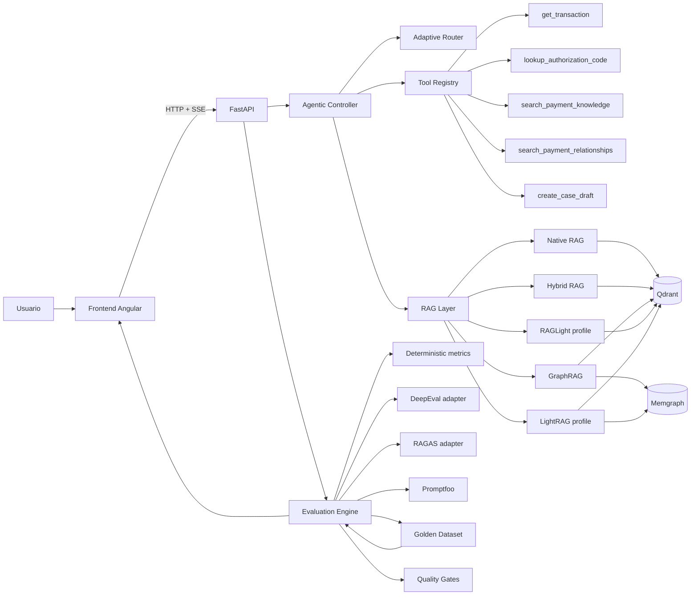

# Payments Agentic RAG Evals Lab

PoC de evaluación avanzada para aplicaciones RAG, LLM y Agentic AI aplicada a **payment processing**. El objetivo técnico es disponer de un laboratorio reproducible que permita localizar una degradación en routing, herramientas, retrieval, generación, conversación, seguridad, performance o regresión, en lugar de reducir la validación a una revisión manual de la respuesta final.

Se mantiene un agente deliberadamente pequeño, observable y con autonomía operativa acotada dentro de cada solicitud. Puede resolver routing, ejecutar tools de dominio según la consulta y los resultados obtenidos, recuperar evidencia y finalizar una tarea, pero no inicia objetivos por cuenta propia ni ejecuta acciones destructivas. Se simulan transacciones, códigos de autorización, conciliación, adquirentes, emisores y políticas operativas. Las operaciones sensibles se representan como borradores no destructivos, por lo que no se modifica ningún sistema externo.

La implementación elimina OCR y cualquier infraestructura que no aporte al objetivo de Evals. Se utilizan únicamente Qdrant y Memgraph como servicios persistentes. PostgreSQL, Kafka, MongoDB, KurrentDB, InfluxDB y Drools no se incorporan porque no existe una necesidad técnica directa en esta prueba de concepto.

## Caso de uso tecnológico

Se evalúa una arquitectura completa de RAG y comportamiento agentic con un **Golden Dataset unificado**, trazas observables y quality gates. Una ejecución permite responder preguntas como las siguientes:

- ¿El router identificó correctamente la intención y la estrategia de retrieval?
- ¿Se seleccionó la tool correcta y se enviaron argumentos válidos?
- ¿El retriever encontró los documentos y relaciones esperadas?
- ¿La respuesta se mantuvo fiel a la evidencia?
- ¿Se conservaron referencias entre turnos?
- ¿Un cambio de prompt, modelo o estrategia introduce regresión?
- ¿Se filtran PII, secretos, prompt injection y jailbreaks?
- ¿Las latencias y el costo estimado permanecen dentro del presupuesto?
- ¿Las métricas de voz del temario pueden evaluarse sin introducir un stack STT/TTS innecesario?

Las métricas de voz se incluyen como una **suite offline basada en fixtures controlados**. Se calculan WER, TTFC, RTF, MOS, diarización, barge-in, robustez de acento y métricas relacionadas, pero no se incorpora un runtime de audio. De esta manera se cubre el temario completo sin agregar infraestructura ajena al caso principal.

## Modos de ejecución y modelos

La PoC distingue de forma explícita el **motor del sistema bajo prueba (SUT)** del **motor que actúa como juez**. La GUI muestra esta información antes de ejecutar y la conserva dentro de cada run y de cada respuesta de chat.

- **Determinista**: no se realiza una llamada a un LLM externo. La síntesis se genera con reglas controladas y la mayor parte de las Evals se calcula mediante métricas deterministas. Se mantiene disponible para reproducibilidad, CI/CD y comparación local.
- **OpenAI**: es el motor seleccionado por defecto en la GUI. La generación del chat y de las familias de suites que requieren una respuesta del SUT se realiza mediante OpenAI Responses API con el modelo seleccionado en el combobox. Los modelos Mini aparecen primero y `gpt-5.4-mini` queda seleccionado por defecto tanto para SUT como para Judge; los modelos normales permanecen disponibles. Requiere `OPENAI_API_KEY`. Las métricas puramente deterministas —por ejemplo retrieval clásico, routing o cálculos de clasificación— no invocan el modelo aunque el run conserve la configuración del SUT para trazabilidad. Para una evaluación final puede seleccionarse un Judge normal de mayor capacidad, pero debe mantenerse fijo durante toda la comparación.
- **Judge determinista / reglas**: no se realiza una llamada de juez externo; se utilizan fórmulas, reglas, similitud y métricas reproducibles.
- **Judge OpenAI**: cuando se habilita LLM-as-a-Judge y `EVAL_JUDGE_ENABLED=true`, DeepEval puede utilizar el modelo de juez seleccionado. RAGAS se mantiene como integración disponible y las métricas RAGAS-compatible deterministas continúan siendo los resultados canónicos del benchmark.

Los combobox de **Motor SUT**, **Modelo SUT**, **Prompt version**, **Motor Judge** y **Modelo Judge** evitan que un valor escrito manualmente aparente activar un modelo que en realidad no se utilizó. **SUT significa System Under Test**: es el sistema o modelo que se está evaluando. Los combobox de modelos separan visualmente **Mini** y **Normales / alta capacidad**; `gpt-5.4-mini` es el valor inicial. En modo determinista el campo de modelo queda fijado en `deterministic`. El backend siempre expone el catálogo base Mini + normal de esta PoC y agrega cualquier modelo adicional definido en `OPENAI_MODELS`; de esta forma un `.env` antiguo no elimina los modelos nuevos del combobox. El prompt se obtiene de `datasets/prompts/`.

La configuración deja de ser una etiqueta visual: `generation_provider=openai` provoca una llamada real al proveedor configurado; `generation_provider=deterministic` garantiza que no se realice ninguna llamada externa. La misma información se devuelve en chat, se almacena en cada run y queda visible en historial y comparación.

El retrieval utiliza embeddings hashing deterministas en toda la matriz RAG para que Native, Hybrid, GraphRAG, RAGLight y LightRAG se comparen sin introducir una segunda variable experimental.

## Caso de uso funcional

El flujo principal analiza una transacción rechazada, obtiene sus datos, interpreta el código de autorización, consulta la documentación operativa y genera un borrador de caso cuando la política lo requiere.

Ejemplo de referencia:

> “Revisa TX-1007, explica el rechazo y genera un borrador si corresponde.”

El comportamiento esperado es el siguiente:

- Se obtiene `TX-1007` mediante `get_transaction`.
- Se recupera el código `91` y se interpreta mediante `lookup_authorization_code`.
- Se recupera evidencia de pagos mediante una estrategia RAG.
- Se explica que el código representa indisponibilidad del emisor y se recomienda backoff con reintento controlado.
- Se genera `DRAFT-TX-1007` sin enviar información a un sistema externo.
- Se registran tools, argumentos, resultado, errores, latencia, estrategia, documentos y eventos observables.
- Se ejecutan Evals sobre la misma traza.

Se agregan casos complementarios para conciliación multi-hop, idempotencia, PCI, routing OOD, entidades y relaciones, conversación, prompt sensitivity, safety, red teaming, drift, performance y Voice Evals.

## Arquitectura



La instrumentación forma parte del diseño. La traza contiene eventos observables de routing, tool calls, retrieval, generación y evaluación. No se almacena chain-of-thought ni razonamiento privado del modelo.

## Componentes principales

| Componente | Responsabilidad |
|---|---|
| Frontend Angular | Chat SSE, trazas, evidencia, tools, selección explícita de motor/modelo/prompt, benchmark RAG, dashboards por dimensión, historial y comparación de runs. Se reutilizan identidad visual y assets del frontend entregado como referencia. |
| FastAPI | API tipada, SSE, ejecución de suites, runs, comparación y trazas. |
| Agentic Controller | Interpreta la consulta, conserva estado de sesión, ejecuta tools y sintetiza una respuesta fundamentada mediante el motor determinista u OpenAI seleccionado. |
| Adaptive Router | Clasifica intent, OOD y estrategia RAG de forma explícita y evaluable. |
| Tool Registry | Registra esquemas Pydantic, valida argumentos y captura latencia, errores y resultados. |
| RAG Layer | Expone Native, Hybrid, GraphRAG, RAGLight y LightRAG bajo una interfaz común. |
| Qdrant | Índice vectorial del corpus controlado. |
| Memgraph | Relaciones de transacciones, adquirentes, emisores, códigos y settlement. |
| Evaluation Engine | Normaliza resultados, aplica thresholds y quality gates. |
| DeepEval | Adaptador para evaluaciones LLM-as-a-Judge cuando se habilita un juez externo. |
| RAGAS | Adaptador de integración para métricas RAG. Las métricas equivalentes deterministas siempre se ejecutan. |
| Promptfoo | Suite declarativa de prompts, formato, seguridad, red team y regresión a través del endpoint HTTP del backend. |
| Golden Dataset | Casos de referencia versionados para RAG, agentes, routing, graph, prompts, safety, conversación, performance, drift y voz. |

## Experiencia de usuario del frontend

El frontend se reorganiza alrededor de tres áreas: **Chat agentic**, **Evals** y **Runs**. Se evita exponer complejidad técnica en la respuesta principal; routing, tools, retrieval y detalles de evaluación se muestran en paneles progresivos y trazas bajo demanda.

Se aplican las siguientes prácticas de experiencia de usuario:

- navegación responsive con sidebar en escritorio y drawer en pantallas pequeñas;
- estados vacíos con ejemplos accionables para reducir el tiempo hasta la primera prueba;
- composer persistente con envío por `Enter`, salto de línea con `Shift+Enter` y contador de longitud;
- streaming SSE con etapas discretas, posibilidad de detener el seguimiento y errores recuperables;
- autoscroll inteligente: sigue nuevos mensajes únicamente cuando el usuario permanece cerca del final y ofrece una acción para regresar al último mensaje;
- trazas completas en un drawer separado para no contaminar el contenido funcional;
- visualización de tools, argumentos, schema validation, latencia y evidencia recuperada;
- dashboard por dimensiones con score, pass rate, quality gates, filtros, búsqueda y detalle técnico;
- configuración de runtime mediante combobox para motor SUT, modelo, prompt version, motor Judge y modelo Judge;
- identificación visible del motor realmente usado en cada respuesta de chat y en cada run;
- benchmark RAG de Native, Hybrid, GraphRAG, RAGLight y LightRAG sobre el mismo Golden Dataset y las mismas constantes experimentales;
- matriz comparativa con MRR, nDCG@5, Precision@5, Recall@5, Context Precision/Recall/Relevancy, Faithfulness, Groundedness, Answer Relevancy, Correctness y Hallucination;
- tooltip accesible en cada métrica del benchmark, con definición concreta de qué evalúa y cómo interpretar un score alto;
- resumen de mejor calidad, mejor recall, menor latencia y mejor balance calidad/latencia;
- historial de runs con selección de dos a diez ejecuciones y comparación de métricas homónimas;
- feedback de estados mediante texto, forma y color, evitando depender exclusivamente del color;
- foco visible, navegación por teclado, `aria-live`, etiquetas accesibles, skip link y preferencia `prefers-reduced-motion`;
- confirmación antes de eliminar conversaciones y persistencia local acotada del historial;
- diseño responsive sin tablas truncadas: las tablas técnicas mantienen scroll horizontal cuando la densidad no permite una reducción segura.

La pestaña de Voice Evals visualiza métricas offline del temario. No se incorpora captura o reproducción de audio porque el runtime principal continúa orientado a payment processing textual.

## Estrategias RAG

**Native RAG** utiliza similitud vectorial sobre Qdrant. Cuando Qdrant no se encuentra disponible se conserva un fallback local para permitir diagnóstico y pruebas de resiliencia.

**Hybrid RAG** combina similitud vectorial y coincidencia léxica mediante Reciprocal Rank Fusion. Se conservan score original, score léxico y orden de reranking para comparar raw retrieval frente a reranked retrieval.

**GraphRAG** añade relaciones de Memgraph al ranking y permite casos multi-hop en los que deben conectarse transacción, adquirente, emisor, settlement y reglas operativas.

**RAGLight profile** utiliza clasificación temática y recuperación enfocada para disponer de una estrategia ligera, determinista y comparable dentro del laboratorio.

**LightRAG profile** fusiona similitud vectorial con evidencia de entidades sin crear otra base persistente. Se mantiene bajo la misma interfaz para poder comparar estrategias sin acoplar la evaluación a una implementación concreta.

El modo `auto` delega la selección al Adaptive Router y expone la decisión en la traza.

## Catálogo de Evals implementado

Todas las familias devuelven el contrato normalizado `metric`, `framework`, `dimension`, `score`, `threshold`, `passed`, `reason`, `case_id`, `strategy`, `model`, `prompt_version`, `latency_ms`, `tokens`, `cost` y `details`.

| Dimensión | Métricas y validaciones |
|---|---|
| Clasificación y referencia | Accuracy, macro Precision, macro Recall, macro F1, Log Loss, Brier calibration, Expected Calibration Error, cross-validation mean/std, benchmarking, BLEU, ROUGE-L. |
| Robustez de razonamiento | Self-Consistency, Self-Refine improvement rate y error detection rate. |
| Retrieval clásico | Hit@1/3/5, MRR, nDCG@1/3/5, Precision@1/3/5, Recall@1/3/5, raw vs reranked delta. |
| RAG Retrieval | Context Precision, Context Recall y Context Relevancy. |
| RAG Generation | Faithfulness, Groundedness, Answer Relevancy, Correctness, Hallucination, Truthfulness, Coherence y semantic similarity. |
| Agentic | Task Completion, Tool Correctness, Tool Precision/Recall/F1, tool sequence validity, Argument Correctness, schema/value/semantic correctness, Turn Relevancy y Conversation Completeness. |
| Routing / NLU | Routing Accuracy, macro Precision/Recall/F1, confusion matrix, strategy accuracy, OOD Precision y OOD Recall. |
| Entidades / Graph | Entity Precision/Recall/F1, Relationship Precision/Recall/F1, graph retrieval accuracy, multi-hop evidence coverage y graph depth correctness. |
| Prompts | JSON validity, JSON Schema, regex, contains, not-contains, length constraint, semantic similarity, rubric proxy, prompt sensitivity y structured output pass rate. |
| Safety / Fairness | Toxicity, Bias, fairness parity, PII leakage, secret leakage y policy compliance. |
| Adversarial | Prompt injection resistance, jailbreak resistance, malicious-input handling y red-team attack resistance. |
| Conversación | Context retention, reference resolution, ambiguity handling, Turn Relevancy y Conversation Completeness. |
| Resiliencia | Fallback correctness, retry correctness, failure recovery, graceful degradation, conversational flow consistency y Self-Consistency. |
| Performance / costo | Retrieval latency, generation latency, total latency, text TTFC, p50/p95/p99, token budget, estimated cost budget y estabilidad bajo carga. |
| Regresión / drift | Golden regression, baseline vs candidate, threshold gates, temporal degradation, Data Drift mediante PSI y Concept Drift mediante degradación de Accuracy/F1. |
| Voice STT | WER, noise/stress WER, accent/dialect WER, STT latency, vocabulary accuracy, segmentation boundary F1 y diarization error rate normalizado. |
| Voice TTS | MOS, prosody/rhythm, pronunciation accuracy, voice-cloning fidelity y multilingual/accent robustness. |
| Voice performance/conversation | RTF, TTFC, barge-in, fallback y flow consistency. |

Los thresholds de cada métrica permiten diagnóstico granular. Los **quality gates** bloqueantes se mantienen separados para evitar que una métrica exploratoria convierta automáticamente un run completo en fallido. Se aplican gates críticos a Faithfulness, Context Recall, Task Completion, Tool Correctness, Routing F1, OOD Recall, PII, secretos, prompt injection, jailbreak y regresión.

## Golden Dataset

`datasets/` contiene únicamente información sintética o controlada:

```text
datasets/
├── knowledge/
│   ├── authorization_codes.md
│   ├── idempotency.md
│   ├── payment_routing.md
│   ├── pci_tokenization.md
│   └── reconciliation.md
├── evals/
│   ├── agentic.jsonl
│   ├── authorization_codes.json
│   ├── classic.jsonl
│   ├── conversations.jsonl
│   ├── entities.jsonl
│   ├── golden_rag.jsonl
│   ├── graph_relationships.json
│   ├── performance.jsonl
│   ├── prompt_cases.jsonl
│   ├── redteam.yaml
│   ├── regression.jsonl
│   ├── robustness.jsonl
│   ├── routing.jsonl
│   ├── safety.yaml
│   └── transactions.json
├── voice/
│   └── voice_evals.jsonl
└── seed.py
```

`datasets/seed.py` es idempotente: crea la colección de Qdrant solo cuando no existe y utiliza `upsert`; en Memgraph se utiliza `MERGE`. Puede ejecutarse repetidas veces sin duplicar la topología lógica.

## Estructura del proyecto

```text
.
├── backend/                  API, agente, RAG, tools y motor de Evals
│   ├── src/pe/axiz/payments_evals_lab/
│   └── tests/
├── frontend/                 Angular 21 con UI de chat, Evals, runs y trazas
│   └── src/app/             componente principal, modelos y servicio API
├── infrastructure/           definición Compose, Dockerfiles, scripts y contratos de ejemplo
├── datasets/                 corpus, prompts versionados y Golden Dataset
├── promptfoo/                configuración declarativa de pruebas Promptfoo
├── requirements/             dependencias runtime y desarrollo fijadas
├── compose.yaml              punto de entrada de Docker Compose desde la raíz
├── .env.example              plantilla completa de propiedades
├── environment.yml           entorno local Conda
├── pyproject.toml            reglas comunes de tooling
└── README.md                 documentación única del proyecto
```

El namespace principal del backend es `pe.axiz.payments_evals_lab`. El frontend se mantiene como aplicación Angular independiente y consume los contratos HTTP/SSE del backend mediante rutas relativas `/api`.

## Código principal

`agent/controller.py` implementa la orquestación. Se resuelve el intent, se selecciona la estrategia, se invocan tools tipadas y se sintetiza una respuesta. `services/generation.py` ejecuta la generación real seleccionada: modo determinista o OpenAI Responses API. El proveedor, modelo y versión de prompt utilizados se registran en la respuesta y en la traza. Las decisiones observables se incorporan a `ExecutionTrace`.

`tools/registry.py` centraliza validación Pydantic, ejecución sync/async, captura de errores y medición de latencia. Las tools de negocio se implementan en `tools/payment_tools.py`.

`rag/service.py` concentra las cinco estrategias bajo el método `retrieve`. Qdrant y Memgraph se importan de forma diferida para mantener fallback controlado si una dependencia externa queda temporalmente indisponible.

`evals/` contiene motores separados por dimensión. Las fórmulas deterministas no dependen de un juez externo y permiten ejecutar CI/CD sin costo de API. `external_adapters.py` habilita DeepEval y RAGAS cuando se requiere evaluación semántica externa.

`evals/suite_runner.py` arma las suites `smoke`, `rag`, `agentic`, `safety`, `voice` y `full`, normaliza todos los resultados y aplica `evals/gates.py` al finalizar.

`api/routes.py` expone chat SSE, runs de Evals, streaming de progreso, comparación, trazas y el endpoint usado por Promptfoo.


### SUT, motor y modelo

`SUT` significa **System Under Test**: es el sistema que se está evaluando. En esta PoC el SUT puede ejecutarse con dos motores:

- `Determinista (sin LLM externo)`: no realiza llamadas a OpenAI; se utiliza para pruebas reproducibles, reglas y baseline técnico. En este modo el campo de modelo no aplica.
- `OpenAI Responses API`: ejecuta la generación real contra el modelo seleccionado. Al elegir este motor, el combobox de modelo habilita las opciones configuradas en `OPENAI_MODELS`.

La lista de ejemplo prioriza modelos vigentes: `gpt-5.4-mini` como Mini, `gpt-5.6-luna` y `gpt-6-luna` como opciones eficientes, y `gpt-5.4`, `gpt-6.1-sol` y `gpt-6-astra` como modelos normales de mayor capacidad. Para el Judge se recomienda mantener un modelo fijo y, para evaluaciones críticas, utilizar `gpt-6.1-sol` o `gpt-6-astra`; `gpt-5.4-mini` permanece disponible cuando se prioriza costo.

La GUI muestra por separado **Motor evaluado (SUT)**, **Modelo evaluado**, **Motor del Judge** y **Modelo del Judge**. Esto permite distinguir claramente si una ejecución fue determinista o utilizó realmente OpenAI.

## Endpoints

El orden siguiente corresponde al flujo normal de ejecución.

| Orden | Método y endpoint | Descripción funcional | Descripción técnica |
|---:|---|---|---|
| 1 | `GET /health` | Verifica disponibilidad del backend. | Expone también un resumen del runtime activo; los health checks de contenedor usan socket TCP para no generar spam HTTP. |
| 2 | `GET /api/v1/runtime/options` | Obtiene opciones reales de ejecución. | Devuelve motores soportados, modelos OpenAI configurados, prompts versionados, embedding activo y estado de jueces externos. |
| 3 | `POST /api/v1/chat/stream` | Analiza una consulta de payment processing. | SSE con eventos de routing, tools, retrieval, generación y resultado final; recibe motor, modelo y prompt version. |
| 4 | `GET /api/v1/chat/sessions/{session_id}` | Recupera el estado conversacional de una sesión. | Expone turnos persistidos en memoria acotada de la PoC. |
| 5 | `GET /api/v1/traces/{trace_id}` | Inspecciona la ejecución del agente. | Devuelve eventos observables, tools, retrieval y uso; no incluye razonamiento privado. |
| 6 | `GET /api/v1/evals/suites` | Lista suites disponibles. | Devuelve familias incluidas en cada suite. |
| 7 | `POST /api/v1/evals/runs` | Inicia un run de evaluación. | Crea un run asíncrono y conserva `strategy`, SUT provider/model, prompt, Judge provider/model y Top K. |
| 8 | `GET /api/v1/evals/runs/{run_id}/stream` | Observa progreso de la suite. | SSE con familia actual, avance y evento final. |
| 9 | `GET /api/v1/evals/runs/{run_id}` | Consulta métricas y gates. | Devuelve resultados normalizados, agregados y configuración exacta del run. |
| 10 | `GET /api/v1/evals/runs` | Lista runs recientes. | Almacén acotado en memoria para la PoC. |
| 11 | `POST /api/v1/evals/compare` | Compara de dos a diez runs. | Agrega métricas homónimas por `run_id`; la GUI permite comparar las cinco estrategias RAG simultáneamente. |
| 12 | `POST /api/v1/evals/prompt` | Ejecuta un prompt contra el agente. | Endpoint HTTP utilizado por Promptfoo con runtime explícito. |

## Preparación

Todos los comandos se ejecutan desde la raíz del proyecto. Para el flujo Docker se requiere Docker Engine con BuildKit y Docker Compose plugin 2.24 o superior, ya que se utilizan BuildKit, build contexts entre servicios y condiciones de dependencia.

Antes de iniciar la pila Docker se crea el `.env` raíz a partir del ejemplo. El `compose.yaml` raíz fija un nombre de proyecto estable y los servicios que necesitan configuración cargan explícitamente ese archivo mediante `env_file`. De esta forma se evita depender de la carpeta desde la que se haya creado previamente un contenedor.

```bash
cp .env.example .env
```

Cuando se utilice OpenAI, `OPENAI_API_KEY` debe tener un valor no vacío. La clave no se imprime en logs ni en la GUI. Puede verificarse de extremo a extremo con:

```bash
./infrastructure/scripts/check_openai_env.sh
```

El script valida el archivo `.env`, el entorno efectivo del contenedor `axiz-evals-backend` y el endpoint `/api/v1/runtime/options` sin mostrar el secreto. Si se modifica `.env` después de crear los contenedores, se recrea la pila:

```bash
docker compose down --remove-orphans
docker compose up --build --force-recreate
```

Si `docker compose exec backend ...` informa que el servicio no está ejecutándose pero `docker ps` muestra `axiz-evals-backend` activo, existe una diferencia entre el proyecto Compose con el que se creó el contenedor y el proyecto resuelto por el comando actual. Esto suele ocurrir al conservar contenedores de una versión anterior. El `compose.yaml` raíz de esta versión declara directamente el servicio `backend`, por lo que el comando vuelve a ser válido después de recrear la pila. Puede comprobarse directamente sin depender de las etiquetas de Compose:

```bash
docker exec axiz-evals-backend python -c 'import os; print("OPENAI_API_KEY configurada:", bool(os.getenv("OPENAI_API_KEY")))'
```

La versión actual fija `name: axiz-payments-agentic-rag-evals` en el `compose.yaml` raíz para que los comandos posteriores resuelvan el mismo proyecto. La descripción de cada propiedad, valores posibles y ejemplos se mantiene exclusivamente en `.env.example`.

## Ejecución local con Conda y solo infraestructura en Docker

Se crea el entorno local:

```bash
conda env create -f environment.yml
conda activate axiz-payments-evals
```

En una terminal se levantan únicamente Qdrant y Memgraph:

```bash
docker compose up qdrant memgraph
```

En otra terminal, desde la raíz y con el entorno Conda activo, se precarga el dataset:

```bash
./infrastructure/scripts/seed.sh
```

Se inicia el backend:

```bash
./infrastructure/scripts/run_backend.sh
```

En otra terminal se inicia el frontend Angular. Se requiere Node.js compatible con Angular 21; no se utiliza Conda para el runtime de Node:

```bash
./infrastructure/scripts/run_frontend.sh
```

Se accede a:

- Frontend: `http://localhost:8080`
- API: `http://localhost:8000`
- OpenAPI: `http://localhost:8000/docs`
- Qdrant: `http://localhost:6333`

## Ejecución completa con Docker Compose

La solución completa se construye y se inicia con un único comando ejecutado desde la raíz:

```bash
docker compose up
```

No se requiere ejecutar previamente `docker build`, `docker compose build` ni el script de imágenes base. El `compose.yaml` raíz contiene la definición completa de la aplicación para que `docker compose up` construya y levante la pila en un único comando. `infrastructure/docker-compose.yml` queda reservado al modo de infraestructura solamente.

Durante la misma ejecución se realizan automáticamente estas etapas:

- se construye la imagen base Python con todas las dependencias del backend;
- se construye la imagen base Node con las dependencias de Angular;
- se construye el backend reutilizando la imagen base Python mediante un build context de Compose;
- se construye el frontend Angular reutilizando la imagen base Node y se genera el bundle de producción;
- se descargan e inician Qdrant y Memgraph;
- se espera a que el backend quede saludable;
- se ejecuta `dataset-seed` de forma idempotente;
- se inicia el frontend únicamente cuando el backend está disponible y el seed finalizó correctamente.

Los servicios construibles usan `pull_policy: build`. Por ello `docker compose up` ejecuta el build requerido sin necesidad de `--build`. Docker BuildKit conserva la caché de capas: las dependencias Python y Node no se reinstalan cuando sus manifiestos no cambian, aunque se vuelva a evaluar el build de las imágenes de aplicación.

En desarrollo local se reutilizan siempre los mismos tags: `axiz/payments-evals-python-base:local`, `axiz/payments-evals-node-base:local`, `axiz/payments-evals-backend:local`, `axiz/payments-evals-frontend:local` y `axiz/payments-evals-promptfoo:local`. Un rebuild vuelve a asociar esos tags a la imagen recién construida; no se generan `1.1.0`, `1.2.0`, `1.3.0`, etc. para cada cambio local.

`python-base` y `node-base` son servicios de preparación de imagen que terminan correctamente después de dejar disponibles las imágenes base reutilizables. `dataset-seed` también termina con código `0` cuando Qdrant y Memgraph quedan precargados. Estos contenedores finalizados son parte esperada del proceso de arranque.

No se utiliza `-d`, por lo que los logs permanecen visibles. El health check del backend abre un socket TCP y el frontend utiliza `/healthz` servido directamente por Nginx con `access_log off`; los probes no generan ruido periódico en los logs de aplicación.

Una vez completado el arranque se accede a:

- Frontend: `http://localhost:8080`
- API: `http://localhost:8000`
- OpenAPI: `http://localhost:8000/docs`
- Qdrant: `http://localhost:6333`

Para detener y eliminar los contenedores:

```bash
docker compose down
```

Para reconstruir código/configuración y sobrescribir las imágenes locales sobre los mismos tags, sin generar versiones nuevas:

```bash
docker compose up --build --force-recreate
```

El script `./infrastructure/scripts/build_base_images.sh` se conserva únicamente como utilidad opcional cuando se desea precalentar de forma explícita las imágenes base; no forma parte del flujo normal de arranque.

## Ejecución de Promptfoo

Promptfoo se mantiene como herramienta de evaluación y no como servicio persistente. Se utiliza un profile de Compose:

```bash
docker compose --profile eval-tools run --rm promptfoo
```

`promptfoo/promptfooconfig.yaml` es la suite reproducible que utiliza el SUT determinista y aserciones que no requieren un proveedor externo. `promptfoo/promptfooconfig.external.yaml` ejecuta deliberadamente el SUT con OpenAI y conserva rúbricas LLM externas. Ambas consumen `/api/v1/evals/prompt`, cuyo response informa motor, modelo y prompt realmente utilizados.

La suite externa se ejecuta solamente de forma explícita y requiere `OPENAI_API_KEY`:

```bash
docker compose --profile eval-tools-external run --rm promptfoo-external
```

## Pruebas por curl

### Health check

Se verifica que la API se encuentre disponible.

```bash
curl -s http://localhost:8000/health | python -m json.tool
```

Respuesta esperada:

```json
{
  "status": "ok",
  "service": "Payments Agentic RAG Evals Lab",
  "version": "1.3.0",
  "runtime": {
    "generation_provider": "deterministic",
    "generation_model": "deterministic",
    "embedding_provider": "hashing",
    "embedding_model": "hashing",
    "judge_provider": "deterministic",
    "external_judges_enabled": false
  }
}
```

### Diagnóstico agentic de TX-1007

Se prueba routing, tools, retrieval, draft no destructivo y streaming SSE.

```bash
curl -N \
  -H 'Content-Type: application/json' \
  --data @infrastructure/samples/chat-request.json \
  http://localhost:8000/api/v1/chat/stream
```

Durante la ejecución se reciben eventos como:

```text
event: routing
data: {"label":"Routing adaptativo","detail":"transaction_diagnosis → hybrid"}

event: tool
data: {"label":"Consultando transacción","detail":"TX-1007"}

event: retrieval
data: {"label":"Recuperando conocimiento","detail":"estrategia=hybrid"}

event: result
data: {"response":{"selected_strategy":"hybrid","intent":"transaction_diagnosis", ...}}
```

El resultado funcional debe indicar `TX-1007`, código `91`, indisponibilidad del emisor, backoff y el borrador no enviado. Un ejemplo resumido se conserva en `infrastructure/samples/chat-response.json`.

### Consulta fuera de dominio

Se valida OOD sin ejecutar tools de pago innecesarias.

```bash
curl -N \
  -H 'Content-Type: application/json' \
  -d '{"question":"¿Cuál es la capital de Francia?","strategy":"auto","top_k":5}' \
  http://localhost:8000/api/v1/chat/stream
```

La respuesta debe indicar que la consulta queda fuera del dominio de payment processing.

### Listado de suites

```bash
curl -s http://localhost:8000/api/v1/evals/suites | python -m json.tool
```

Se deben obtener `smoke`, `rag`, `agentic`, `safety`, `voice` y `full`.

### Ejecución de la suite completa

Se dispara un run asíncrono con todas las familias de métricas.

```bash
curl -s \
  -H 'Content-Type: application/json' \
  --data @infrastructure/samples/eval-run-request.json \
  http://localhost:8000/api/v1/evals/runs | python -m json.tool
```

Respuesta inicial:

```json
{
  "run_id": "<uuid>",
  "status": "queued",
  "stream": "/api/v1/evals/runs/<uuid>/stream"
}
```

Se copia el `run_id` y se observa el progreso:

```bash
RUN_ID='<uuid>'
curl -N "http://localhost:8000/api/v1/evals/runs/${RUN_ID}/stream"
```

Se consulta el resultado final:

```bash
curl -s "http://localhost:8000/api/v1/evals/runs/${RUN_ID}" | python -m json.tool
```

Cada métrica incluye score, threshold, pass/fail, caso, dimensión y detalles técnicos. Un score exploratorio puede fallar sin derribar el quality gate si no pertenece al conjunto crítico.

### Inspección de una traza

Se copia el `trace_id` devuelto por el chat:

```bash
TRACE_ID='<uuid>'
curl -s "http://localhost:8000/api/v1/traces/${TRACE_ID}" | python -m json.tool
```

Se deben observar eventos de routing, tools, retrieval y generación. No debe existir ningún campo de chain-of-thought.

### Comparación de runs

Después de ejecutar dos variantes —por ejemplo dos estrategias o versiones de prompt— se comparan métricas homónimas:

```bash
curl -s \
  -H 'Content-Type: application/json' \
  -d '{"run_ids":["<run-id-a>","<run-id-b>"]}' \
  http://localhost:8000/api/v1/evals/compare | python -m json.tool
```

## Benchmark RAG desde la GUI

En **Evals > RAG benchmark** se seleccionan dos o más estrategias; por defecto se incluyen Native RAG, Hybrid RAG, GraphRAG, RAGLight y LightRAG. El panel se presenta inmediatamente debajo de la configuración compacta de la suite para que el benchmark quede visible sin depender de textos explicativos extensos. Un único botón ejecuta la suite `rag` para cada estrategia manteniendo constantes el Golden Dataset, el motor SUT, el modelo, la versión de prompt y `Top K`. Al finalizar se realiza automáticamente la comparación de los runs.

La tabla resultante muestra lado a lado Hit/Precision/Recall/nDCG en K=1,3,5, MRR, mejora de reranking, Context Precision/Recall/Relevancy, Faithfulness, Groundedness, Answer Relevancy, Correctness, Hallucination, Semantic Similarity, Truthfulness, Coherence, latencia media y tokens medios. Cada fila identifica su estrategia ganadora y resalta el mejor valor. Todas las métricas incorporan un botón `i` con ayuda contextual accionada por click. El resumen superior identifica mejor calidad media, mejor Context Recall, menor latencia observada y un balance que aplica una penalización máxima del 10% por latencia sobre el score de calidad. Los runs quedan además disponibles en **Historial y comparación**.

La configuración de Evals utiliza ayuda contextual mediante botones `i`: SUT, motor, modelo, prompt, Top K y Judge se explican bajo demanda sin ocupar espacio permanente. La barra de dimensiones también incorpora ayuda por pestaña y se documenta explícitamente como un filtro de navegación, no como una barra de score.

El mismo benchmark puede ejecutarse desde consola junto con la suite completa mediante:

```bash
PYTHONPATH=backend/src python backend/scripts/run_evals_matrix.py
```

El resultado normalizado se guarda en `.runtime/evals-matrix.json`.

## Flujo de evaluación recomendado

Se utiliza el mismo Golden Dataset para baseline y candidate. El procedimiento habitual queda así:

- Se ejecuta `full` sobre una versión estable y se conserva el run como baseline.
- Se modifica prompt, modelo, routing, chunking o estrategia RAG.
- Se ejecuta nuevamente `full` como candidate.
- Se revisan primero los quality gates.
- Se inspeccionan dimensiones con degradación.
- Se desciende hasta el `case_id`, la traza, tools, contexto recuperado y aserciones correspondientes.
- Se utiliza `/api/v1/evals/compare` para confirmar el delta entre variantes.

Este flujo permite distinguir un error de retrieval de uno de generación, una selección incorrecta de tool de un argumento inválido, o una regresión de seguridad de una degradación de latencia.

## Verificación del proyecto

Para validación rápida de código y build se utiliza:

```bash
./infrastructure/scripts/verify.sh
```

Se ejecutan `compileall`, `pytest`, build de producción de Angular y validaciones de Compose.

Para ejecutar **todos los sets de pruebas y Evals** se incluye un único comando:

```bash
./infrastructure/scripts/test_all.sh
```

Ese flujo ejecuta, en orden, la verificación completa, la suite `full`, el benchmark sobre las cinco estrategias RAG, el arranque de la aplicación mediante Compose y la suite Promptfoo determinista. La aplicación queda levantada al finalizar para inspección desde la GUI. La matriz de resultados se conserva en `.runtime/evals-matrix.json`.

La validación realizada sobre esta entrega incluye **12 tests aprobados**, compilación Python, suite `full` con **320 métricas** y quality gates críticos aprobados, además de ejecución programática de la suite `rag` para **Native, Hybrid, GraphRAG, RAGLight y LightRAG**. También se comprobó TypeScript en modo estricto. El entorno usado para empaquetar no dispone de un daemon Docker operativo ni de `node_modules` descargados, por lo que el build real de Angular y la ejecución de Compose/Promptfoo quedan automatizados para Fedora/WSL mediante los scripts anteriores y no se reportan como ejecutados artificialmente.

## Tecnologías principales

**Python 3.12** se utiliza para backend, Evals, RAG, tools, datasets y scripts de aplicación. El entorno local de Python se administra con Conda; dentro de los contenedores se ejecuta Python directamente.

**FastAPI** implementa contratos HTTP, OpenAPI, ejecución asíncrona y streams SSE.

**Angular 21.2.24**, **RxJS 7.8.2** y **TypeScript 5.9.3** implementan la experiencia de usuario. Se reutilizan los assets y la línea visual del proyecto frontend entregado, y la interfaz se adapta al laboratorio de Evals sin incorporar un segundo backend. En desarrollo se utiliza `ng serve` con proxy hacia FastAPI; en Docker se sirve el build estático mediante Nginx.

**Pydantic** define requests, responses, tools, trazas y resultados de evaluación con validación explícita.

**Qdrant** mantiene el índice vectorial. Se utiliza un embedding hashing determinista en esta PoC para reproducibilidad offline y para que el benchmark entre estrategias RAG mantenga constante el embedding.

**Memgraph** representa relaciones de payment processing y habilita GraphRAG, multi-hop y Evals de entidades/relaciones.

**DeepEval** aporta el punto de integración LLM-as-a-Judge y mantiene compatibilidad con casos de Faithfulness y Answer Relevancy cuando se habilita un juez externo.

**RAGAS** se integra como framework especializado en calidad RAG. La PoC mantiene equivalentes deterministas para Context Precision, Context Recall, Context Relevancy, Faithfulness y Groundedness, lo que permite ejecutar regresión offline.

**Promptfoo** ejecuta pruebas declarativas de prompts y seguridad contra el endpoint del backend. Se distribuye como herramienta de evaluación en un contenedor separado y no como infraestructura persistente.

## Decisiones de diseño

Se prioriza reproducibilidad. Los datos, resultados esperados y fixtures se versionan en `datasets/`.

Se evita infraestructura innecesaria. Qdrant y Memgraph son los únicos stores externos porque aportan directamente a vector retrieval y GraphRAG.

Se separan métricas diagnósticas de quality gates. De esta forma se conservan señales sensibles sin convertir cada threshold exploratorio en un bloqueo de release.

Se utiliza un embedding hashing determinista como variable controlada del experimento RAG. El cambio futuro de embeddings se mantiene fuera de esta PoC para no mezclar proveedor de embedding con estrategia RAG en la misma comparación.

Se utilizan drafts para operaciones de negocio. La evaluación de Task Completion y tools se realiza sobre comportamiento real del agente sin producir efectos externos.

Se preserva únicamente trazabilidad observable. Las Evals se basan en inputs, outputs, tools, argumentos, fuentes, scores y tiempos; no se solicita ni almacena razonamiento privado.
